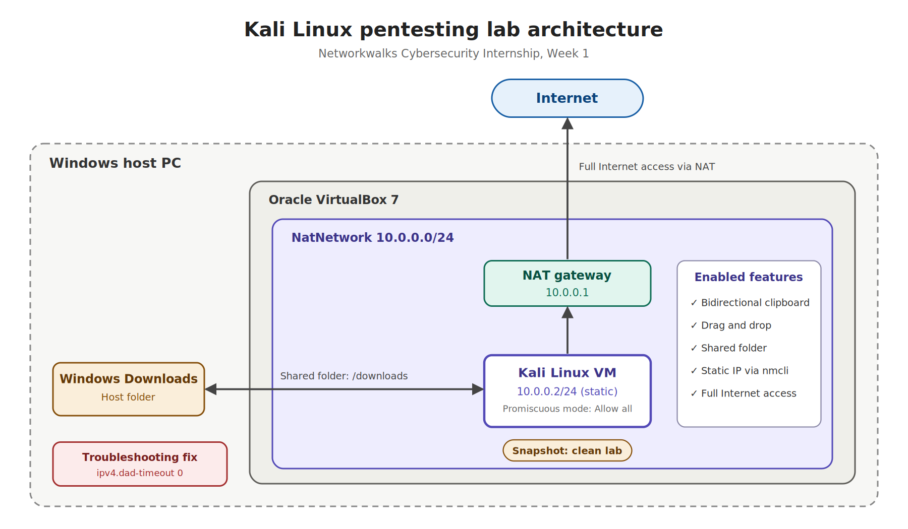
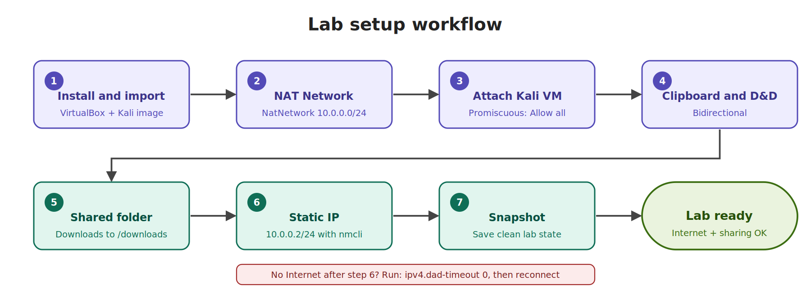

# Networkwalks Cybersecurity Internship — Week 1

## Project
Cybersecurity & Pentesting Lab Setup with VirtualBox and Kali Linux.

## Objective
Build an isolated virtual lab for cybersecurity practice with Kali Linux, using:

- NAT Network `10.0.0.0/24`
- Static Kali IP `10.0.0.2/24`
- Shared folders, clipboard and drag-and-drop between Windows and Kali
- Full Internet access

---

## Lab Architecture



---

## Setup Workflow



---

## Step-by-Step Setup

### 1. VirtualBox and Kali Installation
Imported the pre-built Kali Linux VirtualBox image.

### 2. NAT Network Configuration
Created a NAT Network named `NatNetwork` with the IPv4 prefix `10.0.0.0/24`.

### 3. Kali VM Network Settings
Attached the Kali VM to `NatNetwork` and set **Promiscuous Mode** to **Allow All**.

### 4. Clipboard and Drag-and-Drop
Enabled **Bidirectional** Shared Clipboard and Drag'n'Drop.

### 5. Shared Folders
Shared the Windows Downloads folder to Kali as `/downloads`.

### 6. Static IP Configuration
Configured the static IP `10.0.0.2/24` inside Kali using `nmcli`:

```bash
sudo nmcli connection modify "Wired connection 1" \
  ipv4.addresses 10.0.0.2/24 \
  ipv4.gateway 10.0.0.1 \
  ipv4.dns "8.8.8.8 1.1.1.1" \
  ipv4.method manual
sudo nmcli connection down "Wired connection 1"
sudo nmcli connection up "Wired connection 1"
```

### 7. Snapshot
Took a clean snapshot of the finished lab so it can be restored at any time.

---

## Verification

```bash
ip a                  # confirm 10.0.0.2/24
ip route              # confirm default route via 10.0.0.1
ping -c 3 8.8.8.8     # Internet by IP
ping -c 3 google.com  # DNS resolution
```

---

## Troubleshooting

**Issue:** Kali Linux had no Internet access after configuring the static IP in VirtualBox.

**Fix:** Applied the known VirtualBox 7 / Kali 2026 fix by disabling the DAD (duplicate address detection) timeout:

```bash
sudo nmcli connection modify "Wired connection 1" ipv4.dad-timeout 0
sudo nmcli connection down "Wired connection 1"
sudo nmcli connection up "Wired connection 1"
```


---

## Outcome
A working, isolated Kali Linux lab with a static IP, Internet access, file and clipboard sharing, and a clean snapshot ready for pentesting practice.
